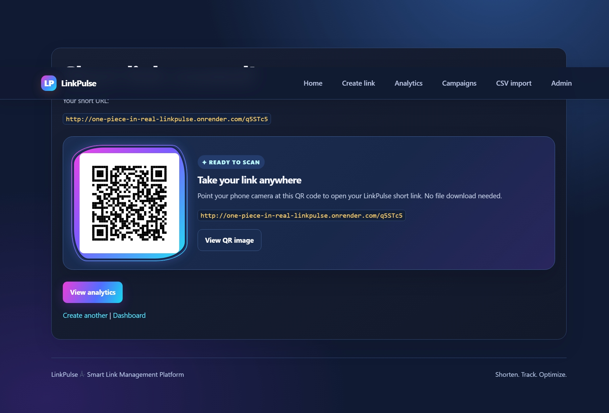
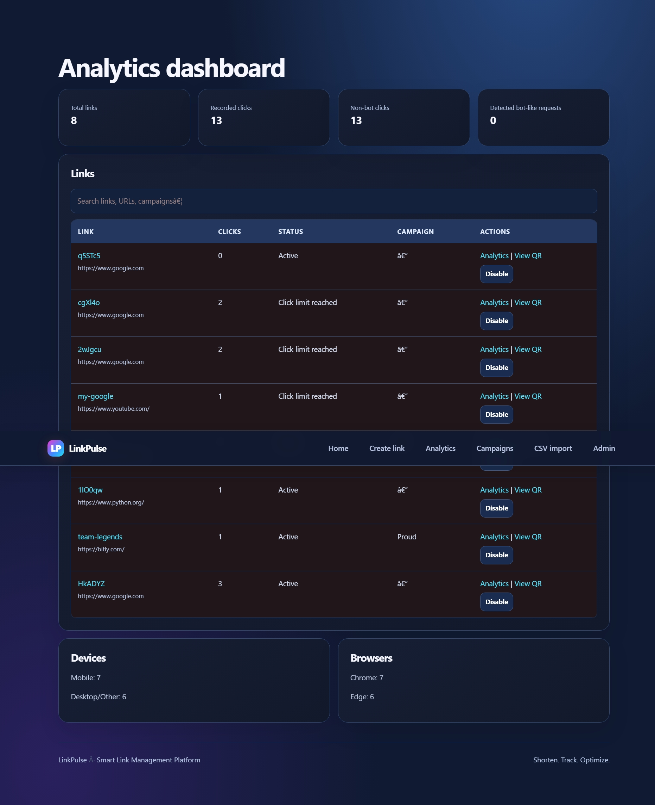
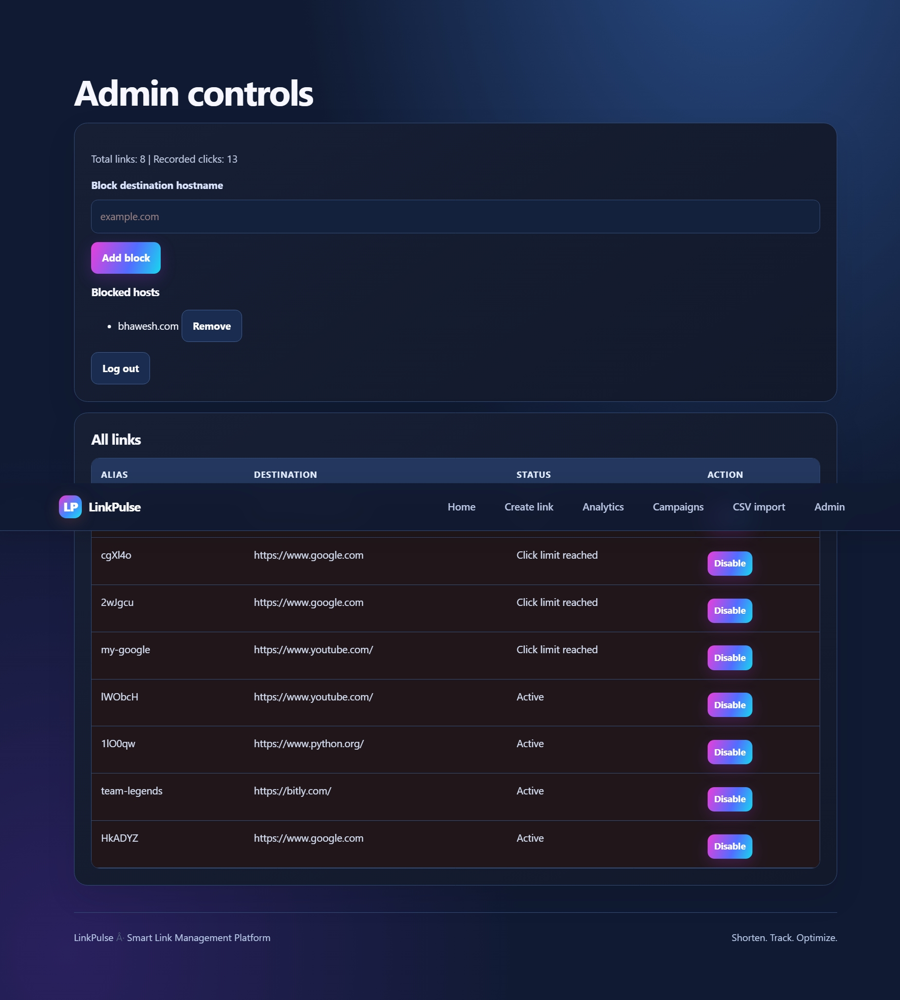

# LinkPulse — URL Shortener & Analytics Platform

**Team Name:** One Piece in Real  
**Project Name:** LinkPulse

LinkPulse is a URL shortening and link management platform built with Python and Flask. It helps users create short links, manage link settings, generate QR codes, and monitor link activity through an analytics dashboard.

---

## 1. Problem Statement

Long URLs are difficult to share, manage, and organize. Basic URL shorteners may not provide sufficient tools for tracking clicks, organizing marketing campaigns, or controlling access to links.

LinkPulse aims to make link management easier by combining URL shortening, link controls, QR code generation, and analytics in one platform.

## 2. Proposed Solution

LinkPulse provides a centralized platform for creating and managing short URLs.

Users can create short links, customize aliases, configure expiry and click limits, protect links with passwords, and organize links using campaigns and tags.

The dashboard helps users monitor link activity and manage their links.

## 3. Features

### URL Management
- Create short URLs from longer destination URLs.
- Use custom aliases for short links.
- Configure link expiry.
- Set click limits.
- Protect links with passwords.
- Enable or disable links.

### Analytics Dashboard
- View total links and recorded clicks.
- Monitor link status.
- Review link activity through the dashboard.
- Organize links using campaigns and tags.

### QR Codes and Bulk Import
- Generate QR codes for short links.
- Import multiple links using CSV files.

### Administrative Controls
- Access administrative link management features.
- Block destination hostnames.
- Manage link availability.

*Note: The features available may depend on the current application configuration.*

## 4. Technology Stack

- **Programming Language:** Python
- **Web Framework:** Flask
- **Database:** SQLite
- **Frontend:** HTML and CSS
- **QR Code Generation:** Python QR code libraries
- **Version Control:** Git and GitHub

## 5. Project Screenshots

The following screenshots demonstrate the current LinkPulse application.

### Home Page


### Create Link



### Short Link Created


### Analytics Dashboard


### Dashboard Details



### Admin Controls



## 6. Installation and Setup

Follow these steps to run LinkPulse locally.

### Prerequisites

- Python installed on your computer.
- Git installed on your computer.
- A terminal such as PowerShell or the VS Code terminal.

### Step 1: Open the Project Folder

Open the LinkPulse project folder in VS Code.

### Step 2: Create a Virtual Environment

Run:

```powershell
python -m venv .venv
```

### Step 3: Activate the Virtual Environment

On Windows PowerShell, run:

```powershell
.\.venv\Scripts\Activate.ps1
```

If PowerShell blocks activation, run:

```powershell
Set-ExecutionPolicy -Scope Process -ExecutionPolicy RemoteSigned
.\.venv\Scripts\Activate.ps1
```

### Step 4: Install Dependencies

Run:

```powershell
python -m pip install -r requirements.txt
```

### Step 5: Start the Application

Run:

```powershell
python app.py
```

### Step 6: Open LinkPulse

Open your browser and visit:

http://127.0.0.1:5000

The application should now be available on your local computer.

## 7. Live Demo

**Status:** Deployment pending.

The application currently runs locally. A public demo URL will be added after deployment.

## 8. Repository Structure

```text
LinkPulse_Advanced/
├── app.py
├── requirements.txt
├── Procfile
├── .gitignore
├── README.md
└── screenshots/
    ├── home.png
    ├── create-link.png
    ├── short-link-created.png
    ├── dashboard.png
    ├── dashboard-details.png
    └── admin.png
```

The `.venv/`, `venv/`, and local SQLite database files should not be uploaded to the public repository.

## 9. Security and Repository Hygiene

- Keep environment files and secrets out of the public repository.
- Use `.gitignore` to exclude virtual environments, local databases, and sensitive configuration files.
- Configure strong secret keys and administrator passwords before deployment.
- Do not publish private credentials in source code or documentation.

## 10. Future Improvements

Potential improvements include:

- Deploying the application with a persistent database.
- Adding user registration and role-based access control.
- Expanding analytics with referrer, device, browser, and location information where available.
- Adding workspaces and folders for link organization.
- Improving campaign reporting and abuse monitoring.
- Adding link-in-bio pages and device-based redirection.

## 11. Team

**Team Name:** One Piece in Real  
**Project:** LinkPulse

---

**Project Status:** Local application developed; public deployment is pending.